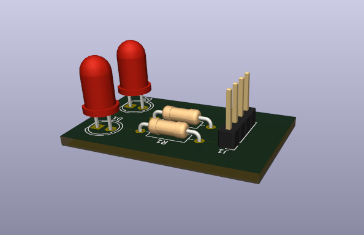

# Avionics Status Indicator PCB (KiCad 10)

A 2-layer hardware status indicator board designed in **KiCad 10.0** for avionics bus debugging (e.g., ARINC 429 parity OK / bus fault telemetry on ESP32 & Arduino Uno).

## Hardware Specs
- **Layers:** 2-Layer FR-4 (F.Cu signal routing, B.Cu solid GND pour with thermal reliefs)
- **Components:** 2x 5mm THT Status LEDs, 2x 330Ω current-limiting resistors (3.3V safe), 1x 4-pin 2.54mm header
- **Verification:** Passed both ERC and DRC with 0 errors and 0 warnings
